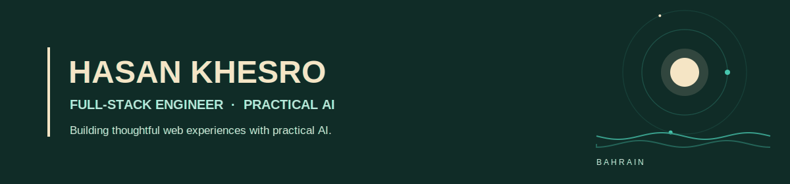

<a href="assets/profile-banner.svg">View static banner</a>

  <a href="https://my-portfolio-six-wheat-43.vercel.app">Portfolio</a> ·
  <a href="https://www.linkedin.com/in/hasankhesro">LinkedIn</a> ·
  <a href="https://github.com/Hsn13">GitHub</a>

Bahrain-based engineer building thoughtful web products and practical AI experiences.

---

### What I build

I build full-stack web apps and explore practical AI features—turning ideas into useful, polished experiences.

**Tools I use** · JavaScript · TypeScript · React · Next.js · Node.js · Gemini API · RAG

### GitHub, at a glance

JavaScript leads my code mix. The cards below track repository activity and the languages I use most.

---

Have an idea to build? <a href="https://my-portfolio-six-wheat-43.vercel.app">Explore my work</a> or <a href="https://www.linkedin.com/in/hasankhesro">connect on LinkedIn</a>.

