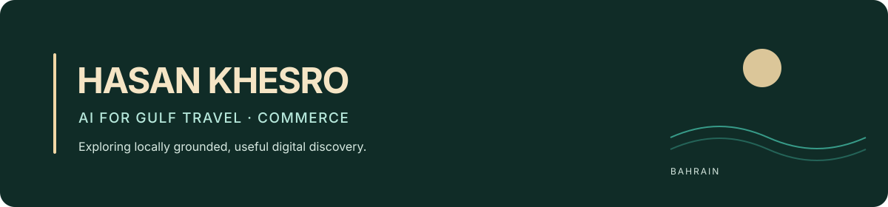

  <a href="https://my-portfolio-six-wheat-43.vercel.app">Portfolio</a> ·
  <a href="https://www.linkedin.com/in/hasankhesro">LinkedIn</a> ·
  <a href="https://github.com/Hsn13">GitHub</a>

Bahrain-based engineer building thoughtful web products and practical AI experiences.

---

### Niche I'm exploring

**AI-assisted discovery for Gulf travel & commerce.** I’m interested in how regional context can make trip planning and shopping experiences more useful.

**Focused toolkit** · TypeScript · Next.js · Gemini API · RAG · LangChain

### GitHub, at a glance

JavaScript leads my code mix. The cards below track repository activity and the languages I use most.

---

Have an idea to build? <a href="https://my-portfolio-six-wheat-43.vercel.app">Explore my work</a> or <a href="https://www.linkedin.com/in/hasankhesro">connect on LinkedIn</a>.

